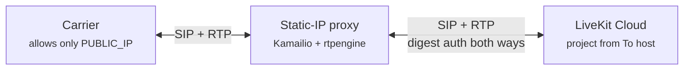

# Connecting LiveKit Cloud SIP to IP-whitelisting carriers with a static-IP Kamailio proxy

Darryn Campbell · October 2026

> **Disclaimer:** I work at LiveKit, but this is a personal project. **This post is written by AI with my guidance to document my experience setting up Kamailio with LiveKit. Use it as a starting point**.

Some SIP carriers only accept traffic from a single whitelisted IP address. LiveKit Cloud can't give you a dedicated static IP, so you can't hand the carrier one address to trust.

The workaround is to put a SIP proxy on a server you control, give that server a static public IP, and have the carrier talk only to the proxy. This repository shows how I did that with [Kamailio](https://www.kamailio.org/) and [rtpengine](https://github.com/sipwise/rtpengine). It includes the config files, the steps I followed, and the problems I hit along the way.

## Contents

- [How it works](#how-it-works)
- [What I tested](#what-i-tested)
- [What's in this repository](#whats-in-this-repository)
- [Prerequisites](#prerequisites)
- [Step 1: Create the server](#step-1-create-the-server)
- [Step 2: Configure LiveKit](#step-2-configure-livekit)
- [Step 3: Install Kamailio and rtpengine](#step-3-install-kamailio-and-rtpengine)
- [Step 4: Configure rtpengine](#step-4-configure-rtpengine)
- [Step 5: Configure Kamailio](#step-5-configure-kamailio)
- [Step 6: Restart and check the configs are live](#step-6-restart-and-check-the-configs-are-live)
- [Step 7: Test inbound calls with a softphone](#step-7-test-inbound-calls-with-a-softphone)
- [Step 8: Switch to your carrier](#step-8-switch-to-your-carrier)
- [Why the config looks like this](#why-the-config-looks-like-this)
- [Troubleshooting](#troubleshooting)
- [Production considerations](#production-considerations)

## How it works



The carrier only ever sees `PUBLIC_IP`. Kamailio handles the SIP signaling, and rtpengine relays the audio. Both are needed: a carrier that whitelists by IP almost always applies the same rule to RTP media, so the audio has to leave from the proxy's IP as well.

Between the proxy and LiveKit, each side authenticates the other with SIP digest credentials. LiveKit challenges the proxy on inbound calls, and the proxy challenges LiveKit on outbound calls.

### What LiveKit expects from the proxy

- **Project lookup.** LiveKit Cloud identifies your project from the **To header host**. The proxy must set it to your LiveKit SIP domain.
- **Trunk matching.** LiveKit matches the inbound trunk on the **To header user**, which is the dialed number normalized to E.164. The proxy must keep that number intact.
- **Proxy to LiveKit auth.** LiveKit challenges inbound INVITEs with `407 Proxy Authentication Required`, using its own realm.
- **LiveKit to proxy auth.** On outbound calls, LiveKit answers `401` and `407` challenges with the outbound trunk's credentials.

### Why a correct Request-URI isn't enough

LiveKit's edge accepts a request if any one of the To, From or Request-URI hosts ends in the LiveKit domain. Project lookup, though, uses only the To host. A call can therefore get past the edge with only the Request-URI right, then fail authentication and dispatch.

Some carriers and PBXs rewrite the To host to an IP address or their own domain; Nexmo is a known case. So the proxy sets the To host itself rather than passing through whatever arrives.

## What I tested

I ran the inbound path end to end against live LiveKit Cloud: caller → proxy → LiveKit → agent, with two-way audio.

| Item | What I used |
| --- | --- |
| Cloud | Google Cloud Compute Engine, `europe-west2` (London) |
| VM | `e2-small`, Ubuntu 26.04 LTS (x86-64), static external IP, 1:1 NAT |
| Packages | Kamailio 6.0.5, rtpengine 13.5.1, from the Ubuntu 26.04 archive |
| "Carrier" | [SipClient](https://github.com/yepher/SipClient) on a Mac on a home broadband connection, SIP over TCP, STUN on |
| LiveKit | Inbound trunk with digest credentials, a dispatch rule, and a running agent |

**Not yet tested against live LiveKit Cloud:**

- **Outbound calls** (LiveKit → proxy → carrier), including LiveKit authenticating to the proxy. The config supports them, but I haven't run them for real. The outbound sections below are marked accordingly.
- **A real IP-whitelisting carrier**, such as Twilio Elastic SIP Trunking with an IP access control list.
- **Inbound SIP over UDP from the caller.** My softphone used TCP. The proxy-to-LiveKit leg used UDP.

## What's in this repository

| File | Purpose |
| --- | --- |
| [`config/kamailio.cfg`](config/kamailio.cfg) | Kamailio routing script. Goes in `/etc/kamailio/kamailio.cfg`. |
| [`config/rtpengine.conf`](config/rtpengine.conf) | rtpengine config. Goes in `/etc/rtpengine/rtpengine.conf`. |
| [`livekit/inbound-trunk.json`](livekit/inbound-trunk.json) | LiveKit inbound trunk, for `lk sip inbound create` |
| [`livekit/outbound-trunk.json`](livekit/outbound-trunk.json) | LiveKit outbound trunk, for `lk sip outbound create` |

The configs are also shown in full below, so you can follow along without leaving this page.

## Prerequisites

### A Linux server with a static public IP

I used Ubuntu 26.04 LTS. Ubuntu 24.04 LTS also works. Both package Kamailio and rtpengine.

- Reserve a static address for the server, such as an AWS Elastic IP or a GCP static external IP.
- Use the **standard** image, not a "Minimal" one. The minimal images lack basics such as `nano`.
- Most clouds use 1:1 NAT: the VM only sees a private IP, and the public IP is mapped onto it. The config handles this; see [Behind 1:1 NAT](#behind-11-nat).

### Values to collect

| Placeholder | Meaning | Example |
| --- | --- | --- |
| `PUBLIC_IP` | The proxy's static public IP. This is the one IP the carrier whitelists. | `198.51.100.20` |
| `LISTEN_IP` | The IP Kamailio binds to: `PUBLIC_IP`, or the VM's private IP behind 1:1 NAT | `10.154.0.2` |
| `CARRIER_NETS` | The carrier's signaling IPs or ranges. For a softphone test, your own public IPv4 address. | `203.0.113.10/32` |
| `CARRIER_HOST` | Where the carrier accepts outbound calls | `sip.carrier.example` |
| `LIVEKIT_SIP` | Your LiveKit SIP endpoint: your project's SIP URI without `sip:`, ideally the region-based form | `abcd1234.eu.sip.livekit.cloud` |
| Inbound credentials | Username and password the proxy uses toward LiveKit | `lk-proxy` / a long random string |
| Outbound credentials | Username and password LiveKit uses toward the proxy | `livekit` / a different long random string |

To find your SIP endpoint, see [SIP endpoint](https://docs.livekit.io/telephony/start/sip-trunk-setup/#sip-endpoint). For the region-based form, see [Region pinning](https://docs.livekit.io/telephony/features/region-pinning/).

### Firewall

| Port | Protocol | Allow from | Purpose |
| --- | --- | --- | --- |
| 5060 | UDP and TCP | Carrier signaling IPs, LiveKit | SIP signaling |
| 30000–40000 | **UDP** | Carrier media IPs, LiveKit | RTP media (rtpengine) |
| 22 | TCP | Your admin IPs | SSH |

LiveKit also needs to reach 5060 on inbound-only setups. When the agent hangs up, LiveKit sends the BYE to the proxy as a new request.

LiveKit publishes static IP ranges for SIP signaling and media in some regions. See [Static IPs](https://docs.livekit.io/deploy/admin/regions/endpoints/#static-ips). To stay inside those ranges, point the proxy at a region-based LiveKit endpoint, and set `destination_country` on the outbound trunk to a country in a covered region. You can then restrict SIP and RTP to the carrier plus LiveKit's ranges. Outside covered regions, LiveKit's source IPs aren't fixed, so leave 5060 and the RTP range open, and rely on digest auth plus the hardening in [Production considerations](#production-considerations).

> **Check the RTP range digit by digit.** If you specify an incorrect range, such as UDP `3000-4000` instead of `30000-40000` the audio between the agent and caller will not get through.

### Ask the carrier to

- Send inbound calls to `PUBLIC_IP:5060`.
- Whitelist `PUBLIC_IP` for outbound calls and media.
- Offer G.711 (PCMU or PCMA) or G.722. LiveKit supports these telephony codecs; see [Codecs](https://docs.livekit.io/reference/telephony/codecs-negotiation/). Kamailio and rtpengine don't transcode in this setup, so the carrier and LiveKit must share a codec.

## Step 1: Create the server

Any cloud works. Here's what I ran on Google Cloud, with the values I used. Change the region, zone and names to suit.

```shell
# Reserve a static external IP
gcloud compute addresses create sip-proxy-ip --region=europe-west2

# Create the VM with that IP. Standard Ubuntu image, not Minimal.
gcloud compute instances create sip-proxy \
  --zone=europe-west2-c \
  --machine-type=e2-small \
  --image-family=ubuntu-2604-lts-amd64 \
  --image-project=ubuntu-os-cloud \
  --address=sip-proxy-ip \
  --tags=sip-proxy

# Open SIP and RTP to instances tagged sip-proxy.
# Narrow --source-ranges if you can (see Firewall above).
gcloud compute firewall-rules create sip-proxy \
  --network=default \
  --direction=INGRESS \
  --target-tags=sip-proxy \
  --allow=tcp:5060,udp:5060,udp:30000-40000 \
  --source-ranges=0.0.0.0/0

gcloud compute firewall-rules describe sip-proxy --format="yaml(allowed,sourceRanges)"

# PUBLIC_IP and LISTEN_IP (the VM's private IP)
gcloud compute addresses describe sip-proxy-ip --region=europe-west2 --format="get(address)"
gcloud compute instances describe sip-proxy --zone=europe-west2-c \
  --format="get(networkInterfaces[0].networkIP)"
```

GCP firewall changes take effect within seconds, with no restart needed on the VM.

## Step 2: Configure LiveKit

Create one inbound trunk, one dispatch rule and, if you need outbound calls, one outbound trunk. Each trunk carries a username and password that the proxy also knows.

| LiveKit setting | Who presents the credentials | Kamailio placeholder |
| --- | --- | --- |
| Inbound trunk `auth_username` / `auth_password` | The proxy, when LiveKit challenges it | `LK_IN_USER` / `LK_IN_PASS` |
| Outbound trunk `auth_username` / `auth_password` | LiveKit, when the proxy challenges it | `LK_OUT_USER` / `LK_OUT_PASS` |

### Inbound trunk

In the LiveKit Cloud dashboard, go to **Telephony → SIP trunks → Create new trunk**. Open the **JSON editor**, select **Inbound**, and paste:

```json
{
  "name": "Carrier via static-IP proxy",
  "numbers": ["+15105550100"],
  "auth_username": "lk-proxy",
  "auth_password": "<long random string>"
}
```

Or, with the [LiveKit CLI](https://docs.livekit.io/reference/developer-tools/livekit-cli/), edit [`livekit/inbound-trunk.json`](livekit/inbound-trunk.json) and run:

```shell
lk sip inbound create livekit/inbound-trunk.json
```

Instead of credentials, you can restrict the trunk by source address with `"allowed_addresses": ["<PUBLIC_IP>"]`. LiveKit support has to enable that field for your project. See [Inbound trunk](https://docs.livekit.io/telephony/accepting-calls/inbound-trunk/).

### Dispatch rule

Create a dispatch rule as you would for any provider, so inbound calls land in a room with your agent. See [Dispatch rule](https://docs.livekit.io/telephony/accepting-calls/dispatch-rule/).

### Outbound trunk (should work, but I did not test it live)

Select **Outbound** and paste:

```json
{
  "name": "Carrier via static-IP proxy",
  "address": "<PUBLIC_IP>",
  "numbers": ["+15105550100"],
  "auth_username": "livekit",
  "auth_password": "<different long random string>"
}
```

Or edit [`livekit/outbound-trunk.json`](livekit/outbound-trunk.json) and run `lk sip outbound create livekit/outbound-trunk.json`.

- `address` is the proxy, not the carrier.
- To keep outbound calls inside a static-IP region, add `"destination_country"`. See [Outbound trunk](https://docs.livekit.io/telephony/making-calls/outbound-trunk/).

Place calls as usual with `CreateSIPParticipant`, using this trunk's ID.

## Step 3: Install Kamailio and rtpengine

```shell
sudo apt update
sudo apt install -y kamailio rtpengine-daemon sngrep nano
```

| Ubuntu | Kamailio | rtpengine |
| --- | --- | --- |
| 26.04 LTS | 6.0.5 | 13.5.1 |
| 24.04 LTS | 5.7.4 | 11.5 |

Every module the config uses ships in the base `kamailio` package. The config needs Kamailio 5.7 or later, because `uac_auth()` must be able to take the realm from LiveKit's challenge.

**Installing the packages starts both services straight away with Ubuntu's default configs.** That matters in Step 6.

## Step 4: Configure rtpengine

Replace `/etc/rtpengine/rtpengine.conf` with [`config/rtpengine.conf`](config/rtpengine.conf). Set `interface` to `PUBLIC_IP`, or to `PRIVATE_IP!PUBLIC_IP` behind 1:1 NAT.

```ini
[rtpengine]
# Userspace forwarding. Use table = 0 only if the rtpengine kernel module is installed.
table = -1
# Public IP. Behind 1:1 NAT use PRIVATE_IP!PUBLIC_IP, e.g. 10.0.0.5!198.51.100.20
interface = 198.51.100.20
# Control socket Kamailio uses (must match rtpengine_sock in kamailio.cfg)
listen-ng = 127.0.0.1:2223
# Control port used by rtpengine-ctl
listen-cli = 127.0.0.1:9900
# Must match the UDP range open in your firewall
port-min = 30000
port-max = 40000
timeout = 60
silent-timeout = 3600
log-level = 6
```

`listen-cli` matters: without it, `rtpengine-ctl` fails with `Use of uninitialized value $listen ... Connection refused`.

## Step 5: Configure Kamailio

Replace `/etc/kamailio/kamailio.cfg` with [`config/kamailio.cfg`](config/kamailio.cfg). Edit only the `#!substdef` lines at the top.

```
#!KAMAILIO
#
# Static-IP SIP proxy between an IP-whitelisting carrier and LiveKit Cloud.
# Kamailio 5.7+ with rtpengine (tested on 5.7.4 and 6.0.5).
# Edit the values in this block only. See README.md for what each one means.
#
# PUBLIC_IP:    the static public IP the carrier whitelists
# LISTEN_IP:    same as PUBLIC_IP, or the VM's private IP behind 1:1 NAT (GCP, AWS)
# CARRIER_NETS: comma-separated carrier source IPs/ranges, e.g. 203.0.113.10/32,203.0.113.11/32
#
#!substdef "!PUBLIC_IP!198.51.100.20!g"
#!substdef "!LISTEN_IP!198.51.100.20!g"
#!substdef "!CARRIER_NETS!203.0.113.10/32!g"
#!substdef "!CARRIER_HOST!sip.carrier.example!g"
#!substdef "!LIVEKIT_SIP!abcd1234.eu.sip.livekit.cloud!g"
#!substdef "!LK_IN_USER!lk-proxy!g"
#!substdef "!LK_IN_PASS!change-me-inbound!g"
#!substdef "!LK_OUT_USER!livekit!g"
#!substdef "!LK_OUT_PASS!change-me-outbound!g"
#!substdef "!RTPE_FLAGS!trust-address replace-origin replace-session-connection ICE=remove RTP/AVP!g"

debug=2
log_stderror=no
log_facility=LOG_LOCAL0
children=8
tcp_children=4
listen=udp:LISTEN_IP:5060 advertise PUBLIC_IP:5060
listen=tcp:LISTEN_IP:5060 advertise PUBLIC_IP:5060
tcp_connection_lifetime=3605
user_agent_header="User-Agent: static-ip-proxy"
server_header="Server: static-ip-proxy"

# On Arm64 servers use /usr/lib/aarch64-linux-gnu/kamailio/modules/
mpath="/usr/lib/x86_64-linux-gnu/kamailio/modules/"
loadmodule "jsonrpcs.so"
loadmodule "kex.so"
loadmodule "corex.so"
loadmodule "tm.so"
loadmodule "tmx.so"
loadmodule "sl.so"
loadmodule "rr.so"
loadmodule "pv.so"
loadmodule "maxfwd.so"
loadmodule "textops.so"
loadmodule "siputils.so"
loadmodule "xlog.so"
loadmodule "sanity.so"
loadmodule "ctl.so"
loadmodule "ipops.so"
loadmodule "dialog.so"
loadmodule "uac.so"
loadmodule "auth.so"
loadmodule "rtpengine.so"

modparam("rr", "append_fromtag", 1)
modparam("dialog", "track_cseq_updates", 1)
modparam("uac", "restore_mode", "auto")
modparam("uac", "auth_realm_avp", "$avp(arealm)")
modparam("uac", "auth_username_avp", "$avp(auser)")
modparam("uac", "auth_password_avp", "$avp(apass)")
modparam("rtpengine", "rtpengine_sock", "udp:127.0.0.1:2223")

request_route {
	if (!mf_process_maxfwd_header("10")) {
		sl_send_reply("483", "Too Many Hops");
		exit;
	}
	if (!sanity_check("17895", "7")) {
		exit;
	}
	# Answer keepalive OPTIONS sent to the proxy itself
	if (is_method("OPTIONS") && uri==myself && $rU==$null) {
		sl_send_reply("200", "OK");
		exit;
	}
	if (has_totag()) {
		route(WITHINDLG);
		exit;
	}
	if (is_method("CANCEL")) {
		if (t_check_trans()) {
			route(RTPE);
			t_relay();
		}
		exit;
	}
	if (is_method("ACK")) {
		if (t_check_trans()) {
			t_relay();
		}
		exit;
	}
	t_check_trans();
	if (!is_method("INVITE")) {
		sl_send_reply("405", "Method Not Allowed");
		exit;
	}
	remove_hf("Route");
	record_route();

	if (is_in_subnet("$si", "CARRIER_NETS")) {
		route(TO_LIVEKIT);
	}
	route(FROM_LIVEKIT);
}

# Carrier -> LiveKit (inbound calls)
route[TO_LIVEKIT] {
	xlog("L_INFO", "carrier->livekit $fU -> $rU (Call-ID $ci)\n");
	# LiveKit identifies the project from the To host and the trunk
	# from the To user, so rewrite both the R-URI and the To header.
	$ru = "sip:" + $rU + "@LIVEKIT_SIP";
	uac_replace_to("sip:$tU@LIVEKIT_SIP");
	t_on_failure("LIVEKIT_AUTH");
	route(RELAY);
}

# LiveKit -> carrier (outbound calls)
route[FROM_LIVEKIT] {
	# LiveKit must authenticate with the outbound trunk's credentials.
	if (!pv_proxy_authenticate("PUBLIC_IP", "LK_OUT_PASS", "0")) {
		proxy_challenge("PUBLIC_IP", "0");
		exit;
	}
	if ($au != "LK_OUT_USER") {
		sl_send_reply("403", "Forbidden");
		exit;
	}
	consume_credentials();
	xlog("L_INFO", "livekit->carrier $fU -> $rU (Call-ID $ci)\n");
	$ru = "sip:" + $rU + "@CARRIER_HOST";
	t_on_failure("CLEANUP");
	route(RELAY);
}

route[RELAY] {
	dlg_manage();
	route(RTPE);
	t_on_reply("MANAGE_REPLY");
	if (!t_relay()) {
		sl_reply_error();
	}
	exit;
}

# Anchor media on this host so the carrier only ever sees PUBLIC_IP
route[RTPE] {
	if (has_body("application/sdp")) {
		rtpengine_manage("RTPE_FLAGS");
	} else if (is_method("BYE|CANCEL")) {
		rtpengine_manage();
	}
}

route[WITHINDLG] {
	if (loose_route()) {
		route(RTPE);
		t_on_reply("MANAGE_REPLY");
		t_relay();
		exit;
	}
	if (is_method("ACK") && t_check_trans()) {
		t_relay();
		exit;
	}
	sl_send_reply("404", "Not Here");
	exit;
}

onreply_route[MANAGE_REPLY] {
	if (has_body("application/sdp")) {
		rtpengine_manage("RTPE_FLAGS");
	}
}

# LiveKit answers the first INVITE with 407; retry once with credentials.
failure_route[LIVEKIT_AUTH] {
	if (t_is_canceled()) {
		rtpengine_manage();
		exit;
	}
	if (t_check_status("401|407")) {
		$avp(auser) = "LK_IN_USER";
		$avp(apass) = "LK_IN_PASS";
		# $avp(arealm) left unset: take the realm from LiveKit's challenge
		if (uac_auth()) {
			t_on_failure("CLEANUP");
			t_on_reply("MANAGE_REPLY");
			t_relay();
			exit;
		}
	}
	rtpengine_manage();
}

failure_route[CLEANUP] {
	rtpengine_manage();
}
```

### Behind 1:1 NAT

On GCP, AWS and most other clouds, the VM only sees its private IP.

- In `kamailio.cfg`, set `LISTEN_IP` to the VM's private IP (`hostname -I` shows it) and `PUBLIC_IP` to the static public IP. Kamailio binds to the private IP, and `advertise` puts the public IP in the Via and Record-Route headers.
- In `rtpengine.conf`, set `interface = PRIVATE_IP!PUBLIC_IP`, for example `10.154.0.2!198.51.100.20`. rtpengine then binds privately and writes the public address into the SDP.

## Step 6: Restart and check the configs are live

Check the syntax first:

```shell
sudo kamailio -c -f /etc/kamailio/kamailio.cfg   # expect: config file ok
```

Then **restart** both services:

```shell
sudo systemctl enable rtpengine-daemon kamailio
sudo systemctl restart rtpengine-daemon kamailio
```

> **Don't rely on `systemctl enable --now`.** The services are already running from the package install, and `--now` won't restart a running service.

Now prove that the edited configs are the ones running:

```shell
# Kamailio on LISTEN_IP:5060 only (UDP and TCP); rtpengine's control socket on 127.0.0.1:2223
sudo ss -lntup | grep -E ':5060|:2223|:9900'

# rtpengine is using your interface and port range
sudo rtpengine-ctl list interfaces

# Kamailio can reach rtpengine: expect "disabled: 0" and "active: 1"
sudo kamcmd rtpengine.show all
```

On my VM, `ss` showed Kamailio on `10.154.0.2:5060` only, `rtpengine-ctl` reported `Port range: 30000 - 40000`, and `kamcmd` showed `disabled: 0` and `active: 1`.

## Step 7: Test inbound calls with a softphone

You don't need a carrier account to test the proxy-to-LiveKit leg. A softphone on your own machine can play the carrier. I used [**SipClient**](https://github.com/yepher/SipClient), a small macOS SIP client built for testing SIP infrastructure. It doesn't need to register: it sends an INVITE straight to an address you give it. It shows the full SIP wire log and timings such as time to first audio, and it can record both sides of the call. Download it from the [releases page](https://github.com/yepher/SipClient/releases) (macOS 14 or later), or build it from source as described in its README.

1. **Find your public IPv4 address.** On your Mac, run:

   ```shell
   curl -4 ifconfig.me
   ```

   Use `-4` as the VM is IPv4-only.

2. **Treat yourself as the carrier.** On the proxy, set `CARRIER_NETS` to that address as a `/32`, then `sudo systemctl restart kamailio`. If your home IP changes, update this setting.

3. **Create a SipClient profile.** In the **Dialer**, select **New** and fill in the fields below. Leave everything else at its default.

   | Section | Field | Value | Why |
   | --- | --- | --- | --- |
   | Target | Transport | **TCP** | This is what I used. UDP should work but is untested. |
   | Target | SIP server host | `PUBLIC_IP`, e.g. `198.51.100.20` | Where SipClient sends the INVITE. It must be the proxy, never LiveKit. |
   | Target | SIP port | `5060` | Kamailio's listening port |
   | Target | To URI | `sip:+15105550100@PUBLIC_IP` | See below |
   | Caller identity | From user | Anything, e.g. `sip-client` | Arrives in LiveKit as the caller's number |
   | Auth | Auth username / password | Leave empty | The proxy trusts you by source IP (`CARRIER_NETS`) and never challenges you |
   | NAT | Use STUN | On | So the SDP advertises your public RTP address, not your Mac's LAN address |
   | Local | Local SIP port | `0` (ephemeral) or `5060` | Either works over TCP. I used `5060`. |
   | Local | Local RTP port | `10000` (default) | STUN maps it to a public port for you |
   | Codecs | PCMU, PCMA | On | G.711, which LiveKit supports |

   **The To URI** has two parts, and the proxy treats them differently:

   - **User part (`+15105550100`):** must be a number on your LiveKit inbound trunk, in exactly the same format, including the `+`. Kamailio passes it through untouched, and LiveKit matches the trunk on it. Get it wrong and LiveKit replies "no trunk matched".
   - **Host part (`@PUBLIC_IP`):** this is just the address you're dialing, the same as SIP server host, as a real carrier would send it. Don't put your LiveKit SIP domain here. Kamailio rewrites the host to `LIVEKIT_SIP` before relaying, which is the To-header rewrite this whole setup depends on. Dialing the proxy's IP proves the rewrite works.

   So with a public IP of `198.51.100.20` and a trunk number of `+15105550100`, the SIP server host is `198.51.100.20` and the To URI is `sip:+15105550100@198.51.100.20`.

4. **Watch the proxy.** Run `sudo sngrep` on the VM, and open **Telephony → Calls** in the [LiveKit Cloud dashboard](https://cloud.livekit.io/projects/p_/telephony).

5. **Place the call**.

In sngrep, a good call looks like this:

- The INVITE from your Mac is relayed to LiveKit with the To header `sip:+15105550100@LIVEKIT_SIP`. The Record-Route header carries a `vst` parameter, which shows that `uac` rewrote the To header.
- LiveKit replies `407`. The proxy sends a new INVITE with `Proxy-Authorization`.
- LiveKit answers `200 OK`. The `200 OK` relayed to your Mac has `c=IN IP4 PUBLIC_IP` in the SDP, which shows rtpengine is anchoring the media.

In LiveKit, the inbound trunk matches, a room is created and your agent joins. You should hear the agent, and it should hear you. When you hang up from either side, `sudo rtpengine-ctl list sessions all` should return to empty.

If the call connects but there's no audio, go straight to the firewall's UDP range. See [Troubleshooting](#troubleshooting).

## Step 8: Switch to your carrier

I didn't test this myself, but it should work.

Once the softphone test works:

1. Set `CARRIER_NETS` to the carrier's signaling IPs and `CARRIER_HOST` to its outbound host, then restart Kamailio.
2. Have the carrier route your number to `PUBLIC_IP:5060`.
3. **Inbound.** Call your number from a mobile phone and repeat the sngrep checks from Step 7.
4. **Outbound (not yet tested live).** Create a SIP participant with the outbound trunk. In sngrep, check that:
   - LiveKit's first INVITE is challenged with `407`, and the second succeeds.
   - The INVITE to the carrier comes from `PUBLIC_IP`, and its SDP advertises `PUBLIC_IP`.
5. **Audio and DTMF.** Talk both ways for over a minute, and press some digits. rtpengine passes RFC 4733 telephone-events through, which is what LiveKit uses for DTMF.
6. **Hang up from each side.** The BYE must reach the far end in both directions.

## Why the config looks like this

- **Direction comes from the source IP.** Requests from `CARRIER_NETS` go to LiveKit. Everything else must pass digest auth as LiveKit's outbound trunk. One consequence: if your caller's IP isn't in `CARRIER_NETS`, the proxy challenges *it* with a `407`.
- **To-header rewrite.** `uac_replace_to()` sets the To host to `LIVEKIT_SIP` so LiveKit can find your project. With `restore_mode=auto`, the carrier's original value is put back in replies and in-dialog requests.
- **Answering LiveKit's 407.** The `LIVEKIT_AUTH` failure route answers the challenge once.
  - The realm AVP is left empty, so `uac_auth()` uses the realm from LiveKit's challenge.
  - `track_cseq_updates` together with `dlg_manage()` increments the CSeq on the retry and keeps later ACK and BYE CSeqs consistent. `uac_auth()` alone doesn't do this.
- **rtpengine only on SDP.** `rtpengine_manage()` is called only when there's an SDP body, or on BYE and CANCEL. It's never called on the 407 retry, because calling it in a failure route deletes the media session. The final failure routes do call it, to clean up.
- **Mixed transports are fine.** My softphone reached Kamailio over TCP, and Kamailio relayed to LiveKit over UDP without any extra config.

## Troubleshooting

| Symptom | Likely cause | Fix |
| --- | --- | --- |
| Call connects and the agent joins, but there's no audio in either direction | RTP port range blocked. Signaling over TCP works regardless of the UDP rules. | Check the cloud firewall's UDP range **exactly** (`30000-40000`, not `3000-4000`). It must match `port-min`/`port-max` in `rtpengine.conf`. |
| Kamailio listens on `127.0.0.1:5060` and every local address. About 33 processes. | Ubuntu's default config is still running | `sudo systemctl restart rtpengine-daemon kamailio` |
| rtpengine logs `FAILED TO CREATE NFTABLES CHAINS OR RULES` | The default rtpengine config is still running | Restart rtpengine after replacing its config |
| `rtpengine-ctl` fails with `Use of uninitialized value $listen` | No `listen-cli` in `rtpengine.conf` | Add `listen-cli = 127.0.0.1:9900` and restart |
| Your softphone or carrier gets a `407` from the proxy itself, with realm `PUBLIC_IP` | Source IP isn't in `CARRIER_NETS`, so the proxy treats the call as coming from LiveKit | Use `curl -4 ifconfig.me` (not an IPv6 address). Check whether your home IP changed. |
| LiveKit shows no call at all | INVITE not reaching LiveKit, or no LiveKit host in the To, From or Request-URI | Check `LIVEKIT_SIP`, DNS from the proxy, and the headers in sngrep |
| LiveKit rejects the call with an auth or dispatch failure, though the Request-URI is your SIP domain | The To host is an IP or another domain, so project lookup finds nothing | Make sure `uac_replace_to()` runs. In sngrep, check the To header on the leg toward LiveKit. |
| `404` or "no trunk matched" | The To user isn't the number on the inbound trunk | Keep `$tU` as the dialed number, in the same format as the trunk's `numbers` |
| Repeated `407` or `401` "Bad credentials" from LiveKit | The proxy's credentials don't match the inbound trunk | Recheck `LK_IN_USER` / `LK_IN_PASS` |
| LiveKit's outbound calls fail with an auth error | LiveKit's credentials don't match the proxy | Recheck the outbound trunk's `auth_username` and `auth_password` against `LK_OUT_USER` / `LK_OUT_PASS` |
| Carrier rejects outbound calls with `403` | The call didn't leave from `PUBLIC_IP`, or the number format is wrong | Confirm the source IP in sngrep, and adjust the dialed number for the carrier |
| One-way audio, or a private IP in the SDP | NAT settings missing | Set `LISTEN_IP` plus `advertise`, and rtpengine's `interface = PRIVATE_IP!PUBLIC_IP` |
| `488 Not Acceptable Here` | No codec in common | Have the carrier offer PCMU, PCMA or G.722 |
| Calls drop after 15 to 30 seconds of silence | The carrier sends no RTP during silence, so LiveKit's media timeout fires | Ask the carrier for comfort noise, or raise `media_timeout`. See [Troubleshooting](https://docs.livekit.io/reference/telephony/troubleshooting/#media-timeout). |
| `sudo: I'm sorry <user>. I'm afraid I can't do that` on GCP | Your browser-SSH session lost its sudo rights | Reconnect with **SSH** from the console. |
| `nano: command not found` | Minimal VM image | `sudo apt install -y nano`, or use the standard image |
| Echo during a softphone test | Speakers and microphone on the test machine | Use headphones |

For packet-level checks, download the call's PCAP from the LiveKit dashboard and compare it with a capture on the proxy:

```shell
sudo tcpdump -i any -w proxy.pcap port 5060 or portrange 30000-40000
```

## Production considerations

A single proxy is a single point of failure, and it's exposed to the internet. Plan for both before going live.

- **High availability.** Run two proxies, each with its own static IP. Ask the carrier to whitelist both and to fail over between them. Alternatively, run an active/standby pair behind one floating IP (keepalived, or a cloud IP you can reassign). Active calls drop on failover unless media state is replicated.
- **Secrets.** Use long random passwords. Keep the inbound and outbound credentials different. When you rotate them, change them in LiveKit and on the proxy together. Don't commit real values to a repository like this one.
- **Abuse protection.**
  - Rate-limit with Kamailio's `pike` module.
  - Drop unsolicited SIP at the firewall wherever you can narrow the source IPs.
- **Encryption.** LiveKit supports TLS signaling and SRTP media. See [Secure trunking](https://docs.livekit.io/telephony/features/secure-trunking/).
  - On the LiveKit leg, add a TLS listener to Kamailio, and set the trunks' `transport` and `media_encryption`.
  - Use rtpengine's SRTP flags for that leg only.
  - The carrier leg can stay plain RTP if the carrier requires it.
- **Regions.** Every call now takes an extra hop. Keep the proxy close to both the carrier's point of presence and the LiveKit region you pin to.
- **Capacity.** rtpengine relays every RTP packet, so size the server for your peak concurrent calls. An `e2-small` was plenty for testing.
- **Change watch.** LiveKit's published static IP ranges and region list can change. Link to the docs from your firewall runbook rather than copying the values.

## License

[MIT](LICENSE)
